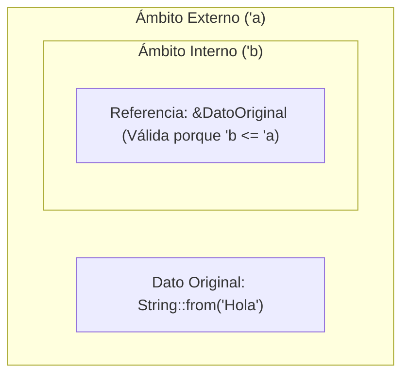

# 📖 Teoría Exhaustiva: Sesión 13 - Tiempos de Vida (Lifetimes `'a`)

---

## 1. ¿Qué es un Lifetime y por qué existe?

En Rust, **toda referencia tiene un tiempo de vida (*lifetime*)**, que es el ámbito (*scope*) exacto durante el cual la referencia es válida. La mayoría de las veces los lifetimes son implícitos e inferidos, pero cuando una función o struct recibe y devuelve referencias que dependen de diferentes orígenes, el compilador requiere **anotaciones genéricas de tiempo de vida** (`'a`, `'b`) para garantizar que **ninguna referencia sobreviva al valor que apunta (*Dangling Reference*)**.

> [!IMPORTANT]
> **Las anotaciones de lifetime no cambian la duración de vida de los datos**. Solo describen las relaciones entre los tiempos de vida de múltiples referencias para que el *Borrow Checker* pueda validar que no ocurran errores de memoria.



---

## 2. Prevención de Referencias Colgantes (Dangling References)

El siguiente código es rechazado por el compilador porque la variable `x` es destruida al salir del bloque interno, dejando a `r` apuntando a memoria liberada:

```rust
fn main() {
    let r;
    {
        let x = 5;
        r = &x; // ❌ ERROR: `x` does not live long enough
    }
    // println!("r: {}", r); // `x` ya no existe aquí
}
```

---

## 3. Anotaciones de Lifetimes en Funciones

Cuando una función retorna una referencia que puede provenir de dos o más parámetros, el compilador no sabe cuál de los dos vivirá más. Necesita que los conectes con un parámetro genérico `'a`:

```rust
// 'a indica que la referencia retornada vivirá al menos tanto como el más corto de 'x' o 'y'
fn mas_largo<'a>(x: &'a str, y: &'a str) -> &'a str {
    if x.len() > y.len() {
        x
    } else {
        y
    }
}

fn main() {
    let s1 = String::from("Rustacean");
    let s2 = "Ferris";
    let resultado = mas_largo(s1.as_str(), s2);
    println!("El más largo es: {}", resultado);
}
```

---

## 4. Las 3 Reglas de Elisión de Tiempos de Vida (*Lifetime Elision*)

El compilador aplica 3 reglas deterministas para evitar escribir `'a` manualmente:

1. **Regla 1:** Cada parámetro que sea una referencia recibe su propio parámetro de lifetime (`fn foo<'a, 'b>(x: &'a i32, y: &'b i32)`).
2. **Regla 2:** Si hay exactamente un parámetro de entrada con referencia, ese lifetime se asigna automáticamente a todas las referencias de salida (`fn primera_palabra(s: &str) -> &str` $\rightarrow$ `fn primera_palabra<'a>(s: &'a str) -> &'a str`).
3. **Regla 3:** Si hay múltiples parámetros de entrada con referencias, pero uno de ellos es `&self` o `&mut self` (método de struct), el lifetime de `self` se asigna a todas las referencias de salida.

---

## 5. Lifetimes en Structs y Métodos

Si un struct almacena una referencia en lugar de un tipo adueñado (`&str` en vez de `String`), debe declarar el parámetro de lifetime:

```rust
pub struct Extracto<'a> {
    pub texto: &'a str,
}

impl<'a> Extracto<'a> {
    pub fn anunciar(&self) -> &str {
        self.texto
    }
}
```

---

## 6. El Lifetime `'static`

El tiempo de vida `'static` indica que los datos permanecen válidos durante **toda la ejecución del programa**:
* Literales de texto: `let s: &'static str = "Hola mundo";` (almacenado en la sección de datos del binario).
* Constantes globales: `static NUMERO: i32 = 42;`.
